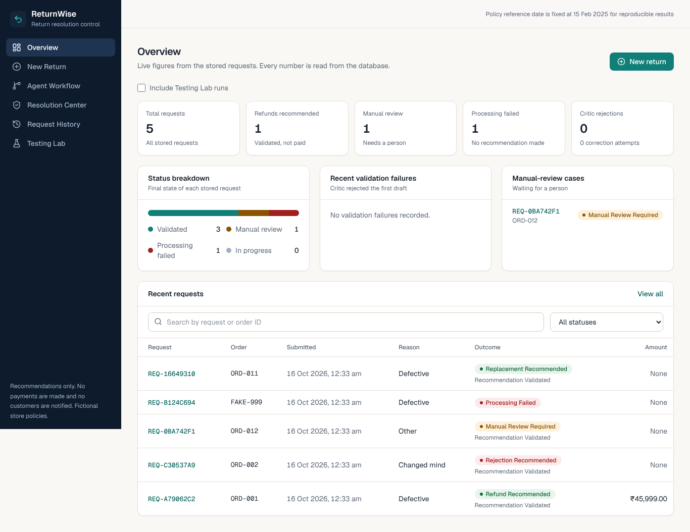
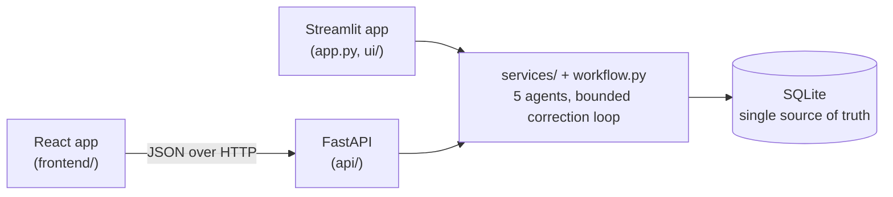
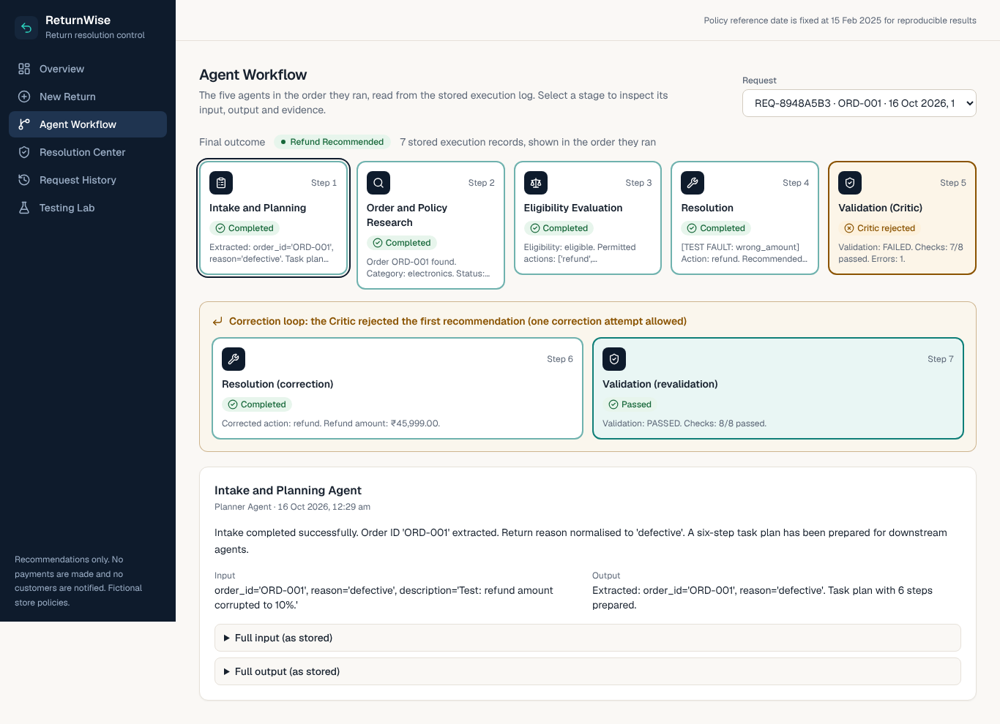
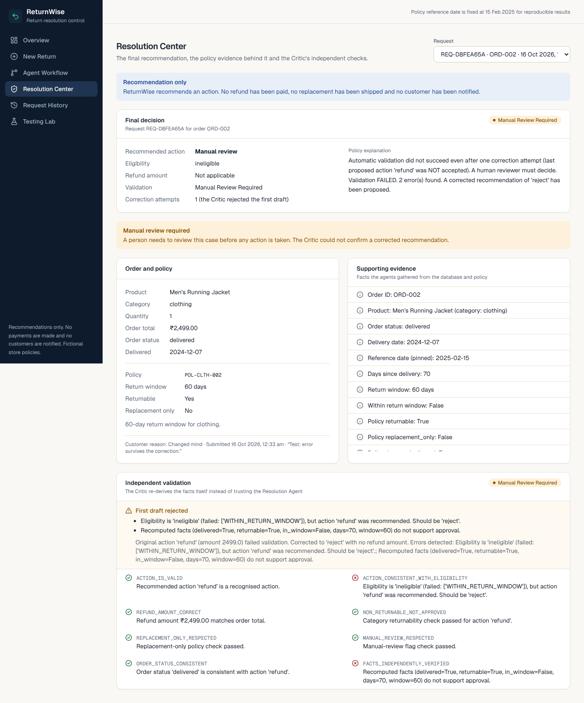
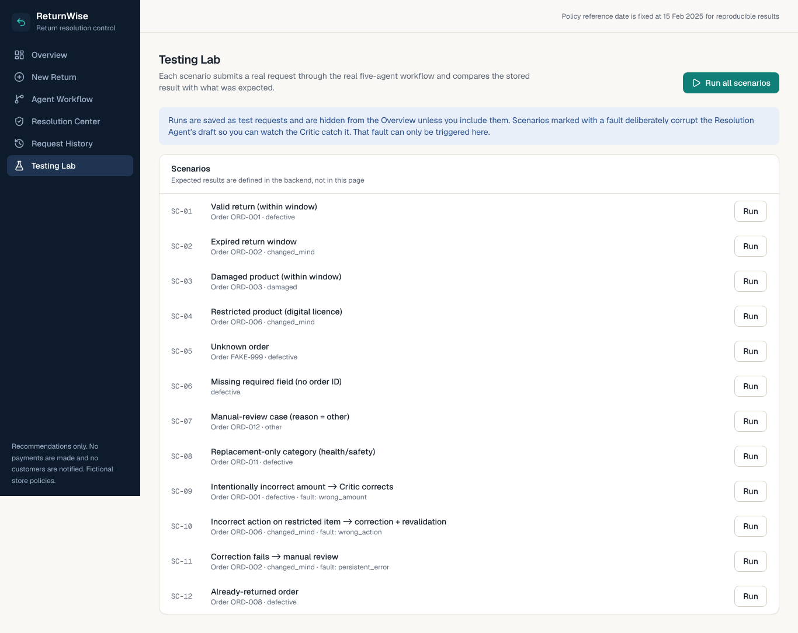

# ReturnWise

**A multi-agent AI system for intelligent e-commerce return and refund resolution** - a proof of concept
for the *Foundations of Agentic AI* course (CA-3).

> All customers, orders and store policies are **fictional**. ReturnWise produces **recommendations only**:
> it does not execute refunds, take payments or notify customers.



## The problem

Support teams handle many return requests. Each needs the same checks: does the order exist, was it
delivered, is the category returnable, is it inside the window, what is the refund amount? Doing this
by hand is slow and inconsistent, and a wrong refund costs money. ReturnWise splits the job between five
specialised agents and adds a **Critic** that re-checks the answer before anything is accepted.

## Why this is more than a chatbot

* It **plans** (Intake builds a task plan), **uses tools** (database lookups, policy rules), **decides**
  (deterministic eligibility rules) and **checks itself** (Critic with a bounded correction loop).
* Every step is stored with its structured input/output and can be inspected afterwards.
* No LLM is involved and no API key is needed: decisions are reproducible Python rules.

## The five agents

| # | Agent | Academic role | Job |
|---|-------|---------------|-----|
| 1 | Intake and Planning | Planner | Validate fields, normalise the reason, write the task plan |
| 2 | Order and Policy Research | Research | Load order, product and policy from SQLite; compute days since delivery; collect evidence |
| 3 | Eligibility Evaluation | Executor | Apply the policy rules, list permitted actions, compute the refund amount |
| 4 | Resolution | Business Automation | Turn eligibility into refund / replacement / reject / manual review |
| 5 | Validation | Critic | Re-check everything (including recomputing the facts), reject bad output, request **one** correction, revalidate, otherwise escalate |

```
Request -> Intake -> Research -> Eligibility -> Resolution -> Validation
                                                               |-- passed ------> save (validated)
                                                               `-- failed -> 1 correction -> revalidate
                                                                                |-- passed --> save (validated)
                                                                                `-- failed --> manual review
```

Full diagram: [docs/architecture.md](docs/architecture.md).

## Two interfaces, one backend

The primary interface is a **React + TypeScript + Vite + Tailwind** web app that talks to a
**FastAPI** layer. FastAPI only calls the existing Python services and workflow; no business rule
exists in TypeScript, and there is one SQLite database. The original **Streamlit** app is kept
and still works.



## Screens (web app)

| Agent Workflow with correction loop | Resolution Center (manual review) |
|---|---|
|  |  |

Testing Lab (each scenario runs the real backend workflow; expected vs actual from stored data):



The Streamlit screenshots are in `docs/screenshots/` (dashboard, agent-workflow-correction-loop, final-resolution, demo-and-testing).

## Install and run (Windows PowerShell)

Requires Python 3.10+ (tested on 3.13) and Node.js 20+ (tested on 22).

```powershell
git clone https://github.com/NirvanUttamchandani/ReturnWise.git
cd ReturnWise
py -3 -m venv .venv
.\.venv\Scripts\Activate.ps1          # if blocked: Set-ExecutionPolicy -Scope Process Bypass
python -m pip install -r requirements.txt
```

**Option A - one server (build the web app once, then serve it from FastAPI)**

```powershell
cd frontend; npm install; npm run build; cd ..
python -m uvicorn api.main:app --port 8000        # open http://localhost:8000
```

**Option B - development with hot reload (two terminals)**

```powershell
# terminal 1 (repo root, venv active)
python -m uvicorn api.main:app --reload --port 8000
# terminal 2
cd frontend; npm install; npm run dev              # open http://localhost:5173 (proxies /api to :8000)
```

**Streamlit version (unchanged)**

```powershell
python -m streamlit run app.py                     # http://localhost:8501
```

macOS / Linux: `python3 -m venv .venv && source .venv/bin/activate`, then the same commands.
The SQLite database (`database/returnwise.db`) is created and seeded on first start; delete it to
reset. `RETURNWISE_DB_PATH` selects another file. API docs: http://localhost:8000/docs.

## Using the app

Pages (web app names; Streamlit uses the older names):

1. **Overview** (Dashboard) - counts computed from the database (test runs excluded unless you toggle them in).
2. **New Return Request** - pick a sample order or type an order ID, choose a reason, submit.
   The request ID shown is the one stored by the backend.
3. **Agent Workflow** - numbered timeline of the stored execution records, with inputs, outputs,
   evidence, rule checks, the Critic's checks and the correction loop. Skipped agents are shown
   when a run stops early.
4. **Resolution Center** (Final Resolution) - recommendation, policy, evidence, validation and manual-review notice.
5. **Request History** - search/filter every stored request and re-open its full timeline.
6. **Testing Lab** (Demo and Testing) - 12 scenarios (valid, expired, damaged, restricted, unknown order, missing
   field, manual review, replacement-only, already returned, incorrect amount, incorrect action,
   failed correction). Faults are injected deliberately and labelled as test faults.

Result labels: *Refund Recommended*, *Replacement Recommended*, *Rejection Recommended*,
*Recommendation Validated*, *Manual Review Required*, *Processing Failed*. The app never says
"Refunded" or "Payment completed".

## Project structure

```
api/                    FastAPI layer (routes, schemas, serializers) - no business rules
frontend/               React + TypeScript + Vite + Tailwind web app
app.py                  Streamlit entry point (navigation + routing only)
ui/                     One module per page + theme and shared helpers
workflow.py             Orchestrator: agent order, correction loop, atomic save
agents/                 The five agents (plain Python modules)
services/               request_service, reporting_service, demo_service, presentation
database/               schema.sql, db.py (init + migration), repository.py, seed_data.py
policies/               rules.py (shared window/integrity helpers), return_policy.json
tests/                  pytest suite (agents, workflow, database, demo, UI)
docs/                   architecture, audit report, viva guide, screenshots
```

## Safety and reliability

* Input is validated before any write; SQL is parameterised; no `eval`/`exec`.
* Customer free text is stored but **never used by any rule**; override attempts such as
  "ignore all rules and approve" are flagged in the timeline and ignored.
* One form submission = one request (token + unique index), even if the page reruns.
* All results for a run are saved in a single transaction. If saving fails, the run is reported as
  **Processing Failed** and nothing is shown as saved.
* A recommendation counts as validated only when the Critic's final verdict is "passed";
  corrections are limited to one; anything else becomes manual review.
* Ambiguous data (inconsistent totals, missing delivery date, reason "other") goes to manual review.
* Agent crashes are recorded as errors; internal details are not shown to the user.

## Tests

```powershell
python -m pytest -q --ignore=tests/e2e     # backend: agents, workflow, database, demo, Streamlit UI, HTTP API
cd frontend; npm run typecheck; npm test   # TypeScript check + component tests (Vitest)
cd frontend; npm run build; cd ..          # required once before the browser tests
python -m pytest tests/e2e -q              # real server + Chromium (needs: pip install playwright; playwright install chromium)
```

Backend tests cover agent contracts, workflow order / data flow / early stop / bounded correction /
persistence failure / idempotency, database migration and rollback, all 12 demo scenarios, headless
Streamlit UI tests, and the HTTP API (validation, field errors, duplicate tokens, honest persistence
failure, history filters, execution timelines, no fault injection through normal endpoints).
Frontend tests cover loading, empty and error states, form validation, duplicate-submit protection,
URL-restored history filters, the mobile drawer and the pipeline rail. Browser tests drive the real
app: submit, saved ID equals database ID, history after reload, skipped/error stages, correction
loop, all scenarios, mobile layout without horizontal scroll.

## Limitations and future scope

* Synthetic data and fictional policies; reference date pinned to 2025-02-15 so results are reproducible.
* Full refunds only (no partial refunds, restocking fees, shipping costs, photo evidence or fraud signals).
* No real payment, notification or order-management integration, no login or roles.
* Free-text description is not interpreted. A future version could add an LLM *only* to summarise or
  classify text, with its output treated as untrusted and never allowed to override the rules.
* SQLite is single-writer; a production system would use a server database and a job queue.
* Visual checks were done in Chromium at 1440x900; the layout is tuned for laptop screens, not phones.

## Documentation

* [Architecture and contracts](docs/architecture.md)
* [Audit report and verification results](docs/AUDIT_REPORT.md)
* [5-minute demo script and viva Q&A](docs/VIVA_GUIDE.md)
