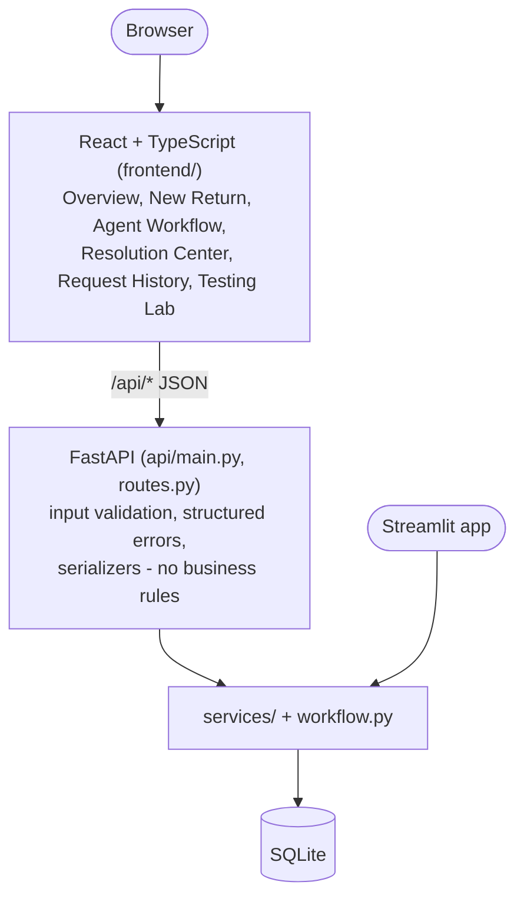
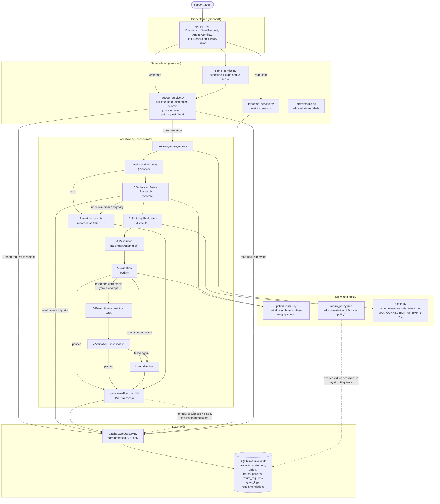

# ReturnWise - Architecture

All store policies, customers and orders are **fictional**. ReturnWise only produces
**recommendations**: it never moves money and never contacts a customer.

## Web layer (added in v1.1)

Endpoints: `GET /api/health, /meta, /orders, /metrics`; `POST /api/requests` (201 new, 200 duplicate
token, 422 field errors, 500 `persistence_failed`); `GET /api/requests` (search, status, action,
pagination), `/api/requests/{id}`, `/api/requests/{id}/executions`; `GET /api/scenarios`,
`POST /api/scenarios/{id}/run`, `POST /api/scenarios/run-all`. Errors always use
`{"error": {"code", "message", "fields"}}` and never include stack traces. The normal create endpoint
cannot inject test faults; only the Testing Lab endpoints can. Labels and statuses come from the
backend (`services/presentation.py`); the frontend only renders them.

## System diagram (matches the code)

Notes on what the diagram does **not** claim: there is no LLM, no external API, no payment or
notification system. Agents are specialised Python modules; "agentic" here means planning,
tool use (database lookups), rule-based decisions, validation and a bounded self-correction loop.

## Execution record

Every step the orchestrator performs becomes one `agent_logs` row (including `skipped` rows):

| order | agent | step_type |
|------:|-------|-----------|
| 1 | Intake and Planning Agent | agent |
| 2 | Order and Policy Research Agent | agent |
| 3 | Eligibility Evaluation Agent | agent |
| 4 | Resolution Agent | agent |
| 5 | Validation Agent | validation |
| 6 | Resolution Agent (correction) | correction (only if step 5 failed and was correctable) |
| 7 | Validation Agent (revalidation) | revalidation (only after step 6) |

`input_json` / `output_json` hold the full structured data, so the Agent Workflow page can be
rebuilt after a restart.

## Agent contracts

| Agent | Academic role | Input | Output (key fields) |
|-------|---------------|-------|---------------------|
| Intake and Planning | Planner | `order_id, reason, description` | `status, order_id, reason, missing_fields, description_flags, task_plan` |
| Order and Policy Research | Research | Intake output | `status, order, policy, days_since_delivery, within_window, data_issues, evidence` |
| Eligibility Evaluation | Executor | Research output + reason | `eligibility, permitted_actions, refund_amount, rule_checks, failed_rules` |
| Resolution | Business Automation | Intake + Research + Eligibility | `recommended_action, refund_amount, supporting_evidence, policy_explanation` |
| Validation | Critic | Resolution + Research + Eligibility | `validation_status, checks_performed (8), detected_errors, corrected_*` |

The Critic's eight checks: valid action; action consistent with eligibility; refund amount equals
order total (and absent for other actions); non-returnable never approved; replacement-only never
refunded; manual-review respected; order status delivered; and **independent recomputation** of
delivered / returnable / in-window from the raw order and policy rows.

## Outcomes

| Request status | Meaning | UI label |
|----------------|---------|----------|
| `validated` | Critic's final verdict = passed | Refund / Replacement / Rejection Recommended (+ Recommendation Validated) |
| `manual_review` | Eligibility said "other"/ambiguous data, or the Critic could not validate even after one correction | Manual Review Required |
| `failed` | Invalid input, unknown order, missing policy, agent crash, or the results could not be saved | Processing Failed |
| `pending` | Created but not finished | Processing |

## Persistence guarantees

* Input is validated **before** any database write.
* One `client_token` per form submission (unique index) prevents duplicate requests on reruns/double clicks.
* All logs, the recommendation and the request status are saved in **one transaction**; on error nothing
  is written, the request is marked `failed` and the UI reports "NOT recorded as completed".
* The UI re-reads the saved request from the database after every write; session state only stores
  the current page and the selected request id.
* Older database files are upgraded with `ALTER TABLE ... ADD COLUMN` (no data is dropped).

## Fictional policy summary (reference date pinned to 2025-02-15)

| Category | Window | Returnable | Replacement only |
|----------|-------:|:----------:|:----------------:|
| electronics, sports, toys, books, appliances | 30 days | yes | no |
| clothing | 60 days | yes | no |
| furniture | 14 days | yes | no |
| health_safety | 30 days | yes | **yes** |
| digital, perishable, intimate_apparel | 0 | **no** | - |

Window rule: inclusive (day 30 is inside a 30-day window, day 31 is not). Refund = stored order total.
Reason `other`, inconsistent order data, or a refund outside `0 < amount <= 50,000` -> manual review.
